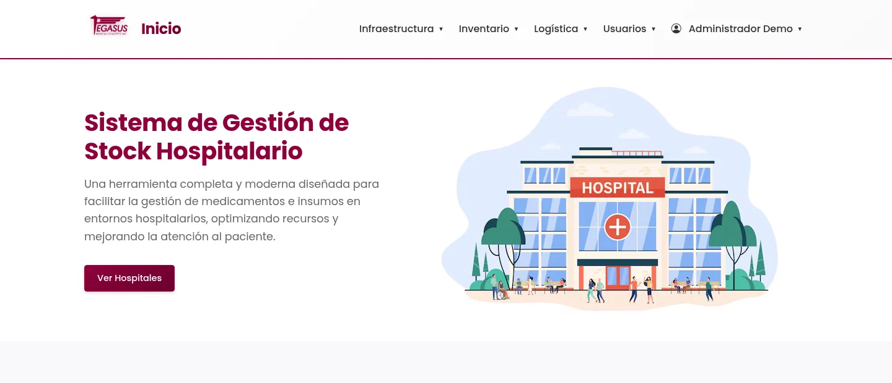
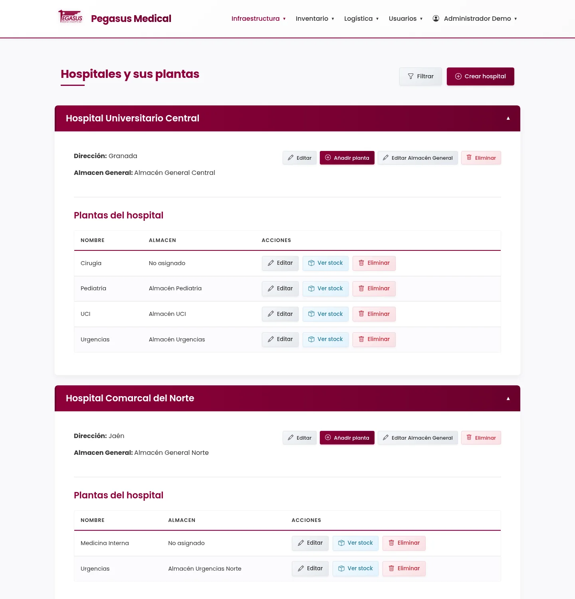
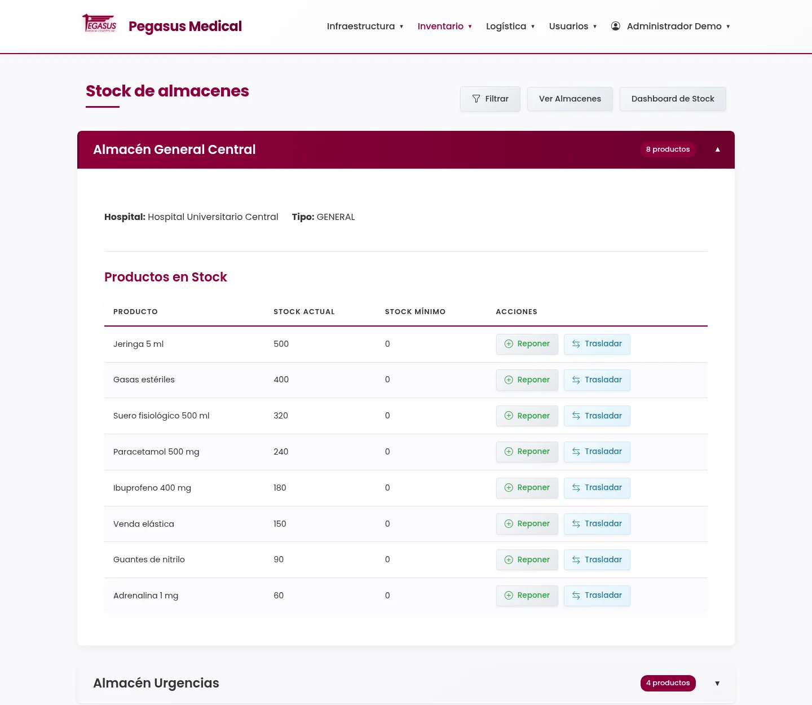
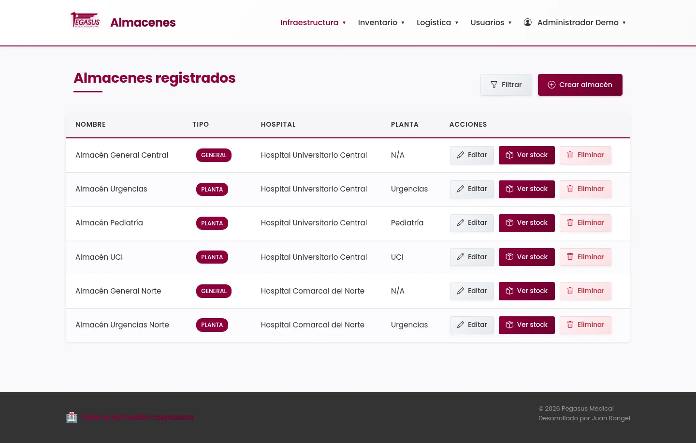
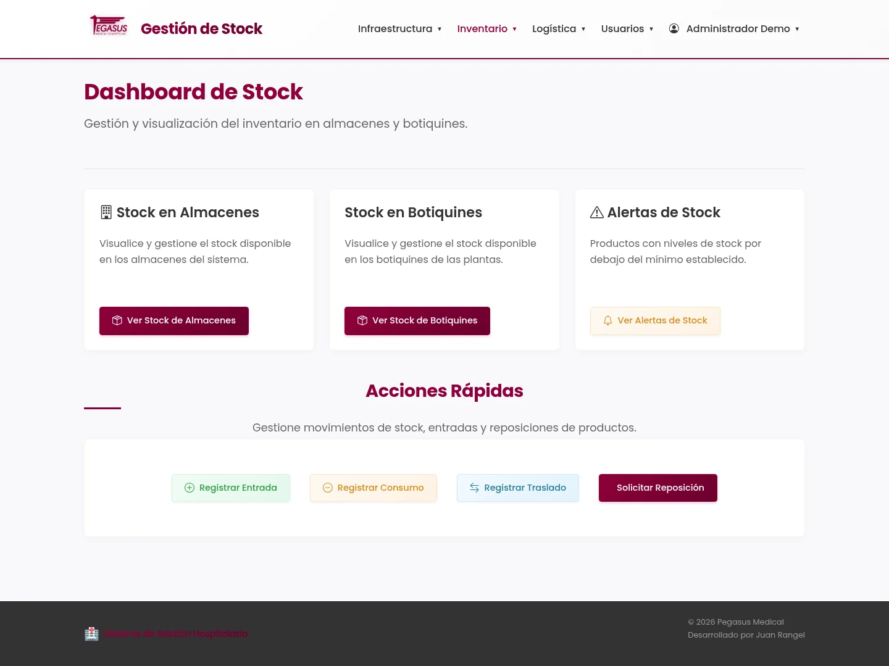
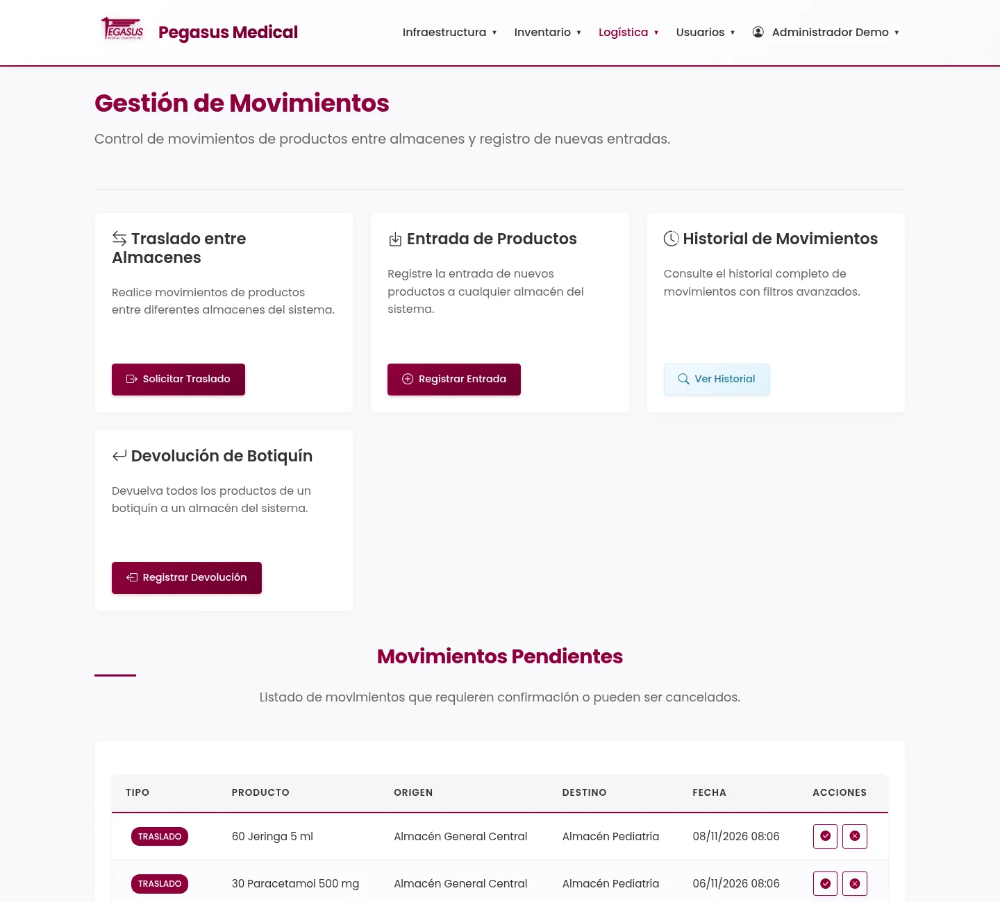
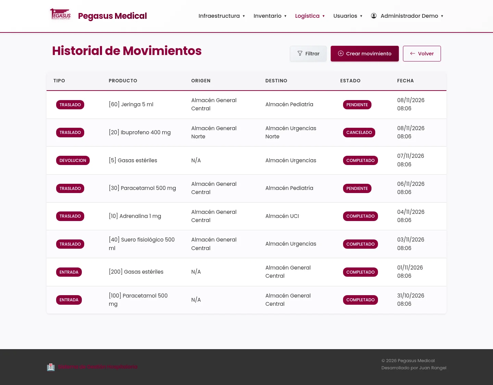
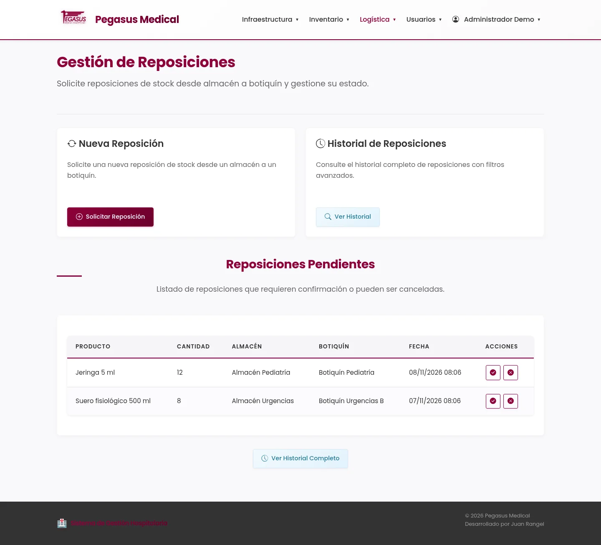
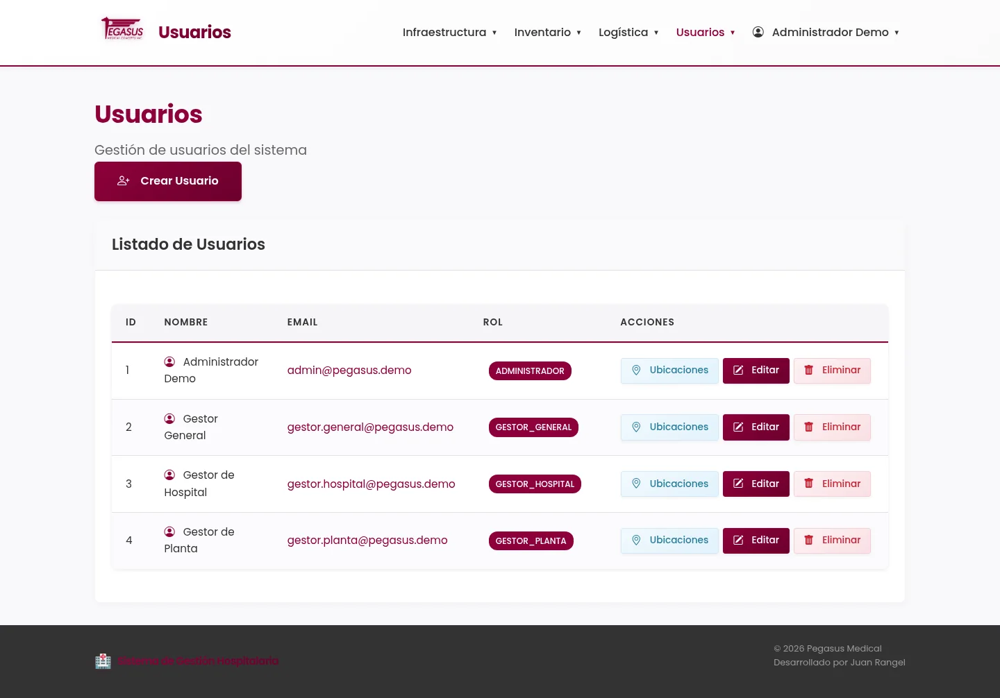

<div align="center">



# Pegasus Medical: Hospital Stock Management

<p>
  <strong>Track medical supplies across hospitals, floors, warehouses, and first-aid kits.</strong><br/>
  Stock levels, transfers, returns, and restock requests, with role-based access per location.
</p>

<p>
  
  
  
  
</p>

<p>
  <a href="#what-it-does">What it does</a> •
  <a href="#screenshots">Screenshots</a> •
  <a href="#how-stock-moves">How stock moves</a> •
  <a href="#quick-start">Quick start</a> •
  <a href="#architecture">Architecture</a>
</p>

</div>

---

Hospitals keep medical supplies in two kinds of places: warehouses and the first-aid kits on each floor. This app keeps one source of truth for both. It models the physical hierarchy of a hospital network, tracks how much of each product sits in each warehouse and kit, and records every movement between them.

The UI is in Spanish. The server is plain PHP 8.2 with no framework, organized as MVC with a service and repository layer, and runs in Docker with MySQL.

## What it does

| Area | What it covers |
| --- | --- |
| **Locations** | Hospitals, floors, warehouses (general or per floor), and first-aid kits with a capacity |
| **Catalog** | Products with code, description, and unit of measure |
| **Stock** | Quantity of each product per warehouse and per kit |
| **Movements** | Transfers between warehouses, entries of new stock, and returns from kits, each with a pending, completed, or cancelled state |
| **Restocks** | Requests to refill a kit from a warehouse, completed or cancelled by a manager |
| **Access control** | Four roles, with hospital and floor managers limited to the locations assigned to them |
| **Accounts** | Login, logout, password change, and user management with hashed passwords |

The app exposes about 50 routes across 12 controllers.

## Screenshots

The screenshots come from the app running locally with demo data. The interface is in Spanish.

<table>
  <tr>
    <td width="50%"></td>
    <td width="50%"></td>
  </tr>
  <tr>
    <td align="center"><sub>Hospitals expand to show their floors and general warehouse</sub></td>
    <td align="center"><sub>Stock per warehouse, with restock and transfer actions</sub></td>
  </tr>
  <tr>
    <td width="50%"></td>
    <td width="50%"></td>
  </tr>
  <tr>
    <td align="center"><sub>Warehouses, by type, hospital, and floor</sub></td>
    <td align="center"><sub>Stock dashboard with quick actions</sub></td>
  </tr>
  <tr>
    <td width="50%"></td>
    <td width="50%"></td>
  </tr>
  <tr>
    <td align="center"><sub>Transfers, entries, returns, and pending movements to confirm</sub></td>
    <td align="center"><sub>Movement history with type and state</sub></td>
  </tr>
  <tr>
    <td width="50%"></td>
    <td width="50%"></td>
  </tr>
  <tr>
    <td align="center"><sub>Pending restock requests, with confirm and cancel</sub></td>
    <td align="center"><sub>Users, roles, and assigned locations</sub></td>
  </tr>
</table>

## How stock moves

The data follows the physical layout of a hospital:

```text
Hospital
└── Floor
    ├── Warehouse (general warehouses belong to the hospital)
    └── First-aid kit
        └── Products and quantities
```

**Movements** change stock between two places and start as pending:

- `TRASLADO` moves a product from one warehouse to another.
- `ENTRADA` registers new stock arriving at a warehouse.
- `DEVOLUCION` returns a product from a kit to a warehouse.

**Restocks** ask for a product to move from a warehouse to a kit. A manager completes or cancels each pending request, and the history keeps all three states: `PENDIENTE`, `COMPLETADO`, and `CANCELADO`.

**Deletion is guarded.** Hospitals and floors are marked inactive and never removed from the database. The service layer refuses to delete a hospital that still has floors, so structure cannot be orphaned.

**Roles** limit what each person sees:

| Role | Scope |
| --- | --- |
| `ADMINISTRADOR` | All locations, and user management |
| `GESTOR_GENERAL` | All locations, and user management |
| `GESTOR_HOSPITAL` | The hospitals assigned to them, and their floors |
| `GESTOR_PLANTA` | The floors assigned to them |

An `AuthMiddleware` checks the role of the session on each protected area.

## Quick start

You need Docker and Docker Compose.

```bash
# 1. Build and start Apache + PHP, MySQL, and phpMyAdmin
docker compose up -d --build

# 2. Install PHP dependencies (generates the autoloader)
docker compose exec apache-php composer install

# 3. Import the database dump
docker compose exec -T mysql sh -c 'mysql -uroot -p"$MYSQL_ROOT_PASSWORD" "$MYSQL_DATABASE"' < stock_hospitalario.sql
```

The app is now at `http://localhost:8080` and phpMyAdmin at `http://localhost:8081`.

The dump creates four users, one per role, whose passwords are not documented. Set your own for the administrator:

```bash
HASH=$(docker compose exec -T apache-php php -d display_errors=0 -r 'echo password_hash("Admin1234!", PASSWORD_BCRYPT);' 2>/dev/null)
echo "UPDATE users SET email='admin@example.com', password='$HASH' WHERE id_usuario=1;" \
  | docker compose exec -T mysql sh -c 'mysql -uroot -p"$MYSQL_ROOT_PASSWORD" "$MYSQL_DATABASE"'
```

Then sign in with `admin@example.com` and `Admin1234!`.

## Architecture

```text
app/
├── public/
│   ├── index.php          Front controller and router
│   └── assets/            CSS and JavaScript (no framework)
├── config/routes.php      Route table
└── src/
    ├── controllers/       Request handling, one per area
    ├── middleware/        AuthMiddleware, role checks
    ├── model/
    │   ├── entity/        Domain objects
    │   ├── repository/    SQL access through PDO
    │   └── service/       Business rules and validation
    └── view/              PHP templates
```

- **Layers:** a controller calls a service, which applies the rules and calls repositories. Controllers never run SQL.
- **Routing:** `index.php` matches the request path against `config/routes.php` and dispatches to a controller method or a view.
- **Data access:** repositories use PDO with real prepared statements (`ATTR_EMULATE_PREPARES` is off) and exceptions on error.
- **Security basics:** passwords are stored with `password_hash`, and every protected area passes through the role middleware.
- **Environment:** Apache, PHP 8.2, and MySQL 8.0 run as three containers on one network, with Xdebug enabled for local debugging.

## Known limitations

- The stock dashboard shows a minimum stock of `0` for every product. Minimum thresholds are not stored yet, so low-stock alerts have no data to work from.
- The readings screen (`/lecturas`) does not resolve product and kit names yet. There is a `TODO` for it in the view.
- `/etiquetas` returns a server error.
- The database credentials are set in `app/src/model/Database.php` and the compose file reads its settings from a tracked `.env`, so this setup is meant for local development.
